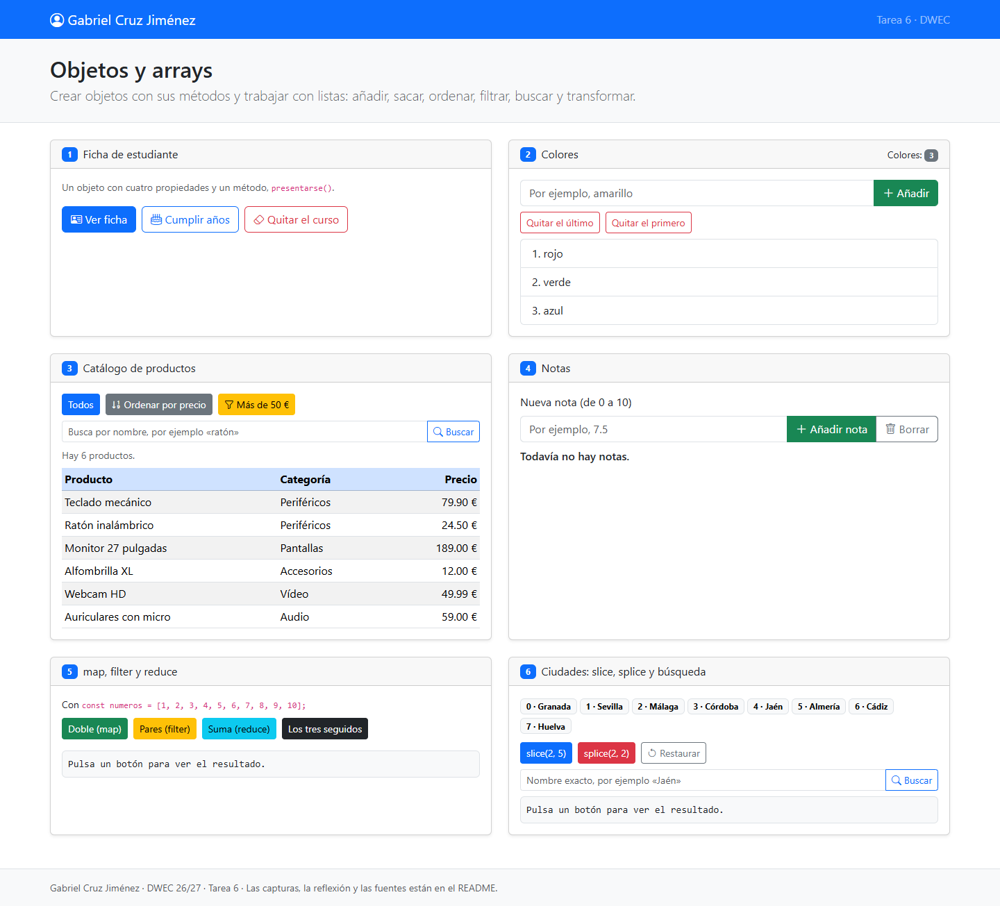
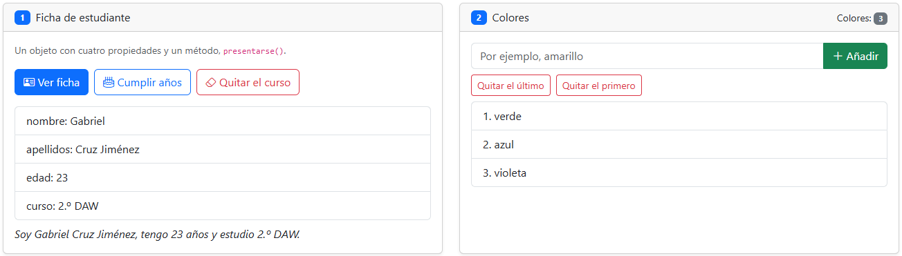
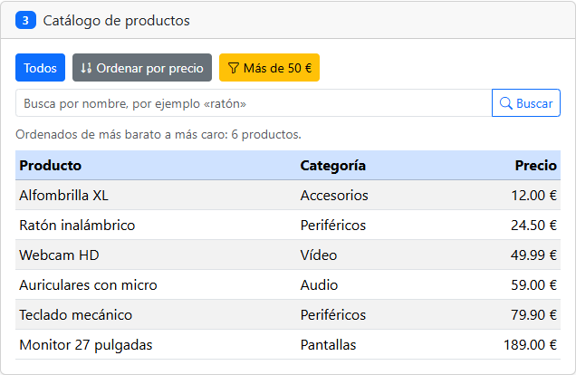
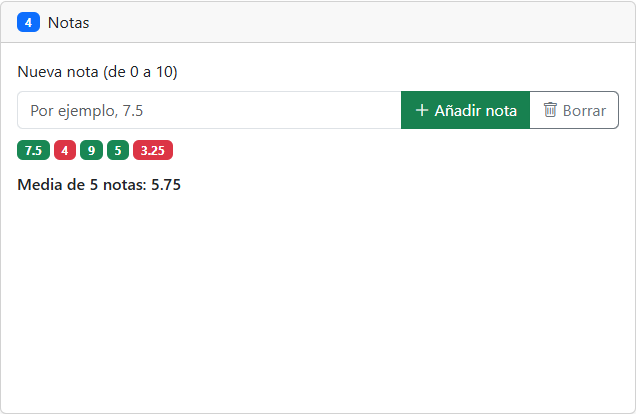
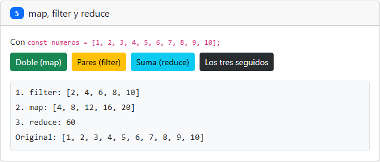
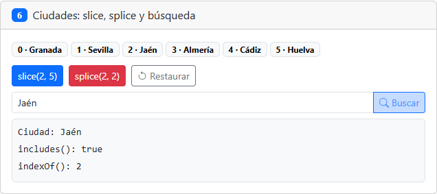

# Tarea 6 · Objetos y arrays

**Autor:** Gabriel Cruz Jiménez · DWEC · 2.º DAW · Curso 2026-27

Abre `index.html` en el navegador y prueba sus seis ejercicios con la consola abierta (F12). Los cambios se pierden al recargar. Bootstrap necesita conexión a Internet.

## Capturas

Capturas locales tomadas durante las pruebas.

### a) La página recién cargada

Se ven el nombre, los tres colores iniciales, seis productos y ocho ciudades. Todavía no hay notas.

### b) Ejercicios 1 y 2 · La ficha y los colores

La edad pasa de 22 a 23. Se añade amarillo con `push`, se quita con `pop`, sale rojo con `shift` y se añade violeta.

### c) Ejercicio 3 · Catálogo ordenado

La comparación `a.precio - b.precio` ordena de menor a mayor. Se ordena una copia para conservar el catálogo original.

### d) Ejercicio 4 · Notas y media

Las notas 7.5, 4, 9, 5 y 3.25 dan una media de 5.75. Los aprobados aparecen en verde y los suspensos en rojo.

### e) Ejercicio 5 · Los tres métodos seguidos

`filter` selecciona los pares, `map` los duplica y `reduce` suma esos dobles: 60. El array original sigue igual.

### f) Ejercicio 6 · Splice y búsqueda

`splice` elimina Málaga y Córdoba. Jaén pasa del índice 4 al 2; `includes` devuelve `true` e `indexOf`, 2.

## Propiedad curso después de delete

Al quitar el curso aparece `curso: undefined`, también en la presentación: `delete` elimina la propiedad y su valor. La clave sigue en el array usado para pintar la ficha.

## Reflexión

`push`, `pop`, `shift` y `splice` cambian el array original. 
`sort` también lo modifica; en el catálogo se aplica a `[...productos]`. 
`slice`, `map` y `filter` devuelven arrays nuevos. 
`reduce` devuelve un resultado; aquí calcula sumas sin cambiar los números. 
En las ciudades, `slice(2, 5)` obtiene tres y mantiene las ocho originales. 
`splice(2, 2)` elimina dos, deja seis y cambia sus posiciones; Restaurar copia `ciudadesOriginal`.

## Fuentes

- [Plantilla del profesor](https://github.com/DRodero/DWEC_2627/tree/main/tema06_plantilla).
- Enunciado facilitado y temas 1 a 6 de DWEC, especialmente el tema 3 (tipos y conversiones), 4 (condiciones), 5 (DOM) y 6 (objetos y arrays).

## Uso de IA

ChatGPT ha generado la solución, redactado este README y automatizado las pruebas y las capturas locales. La solución se ha contrastado con el enunciado y los temas y se ha probado en el navegador.
