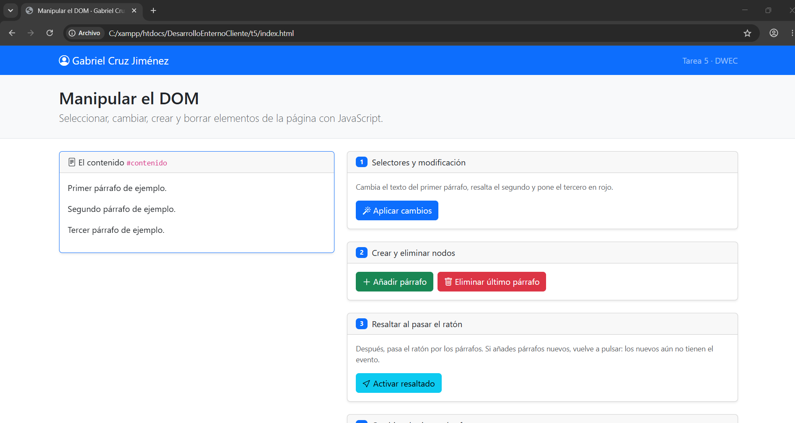
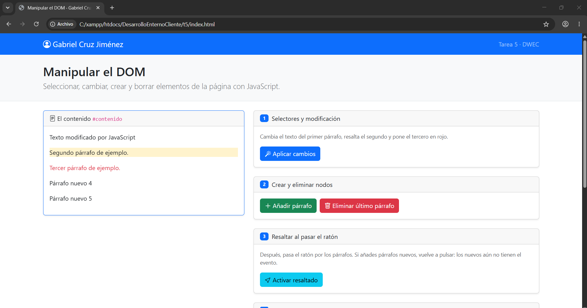
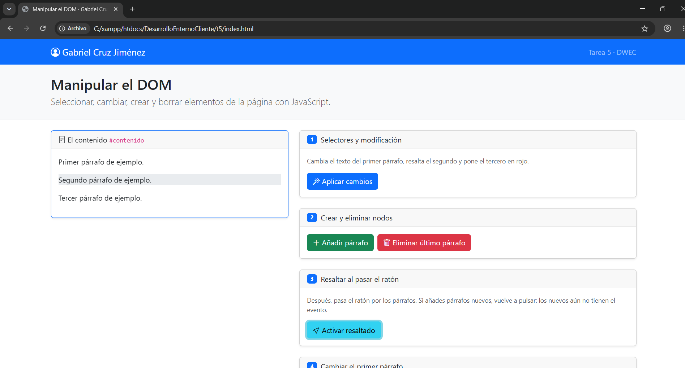
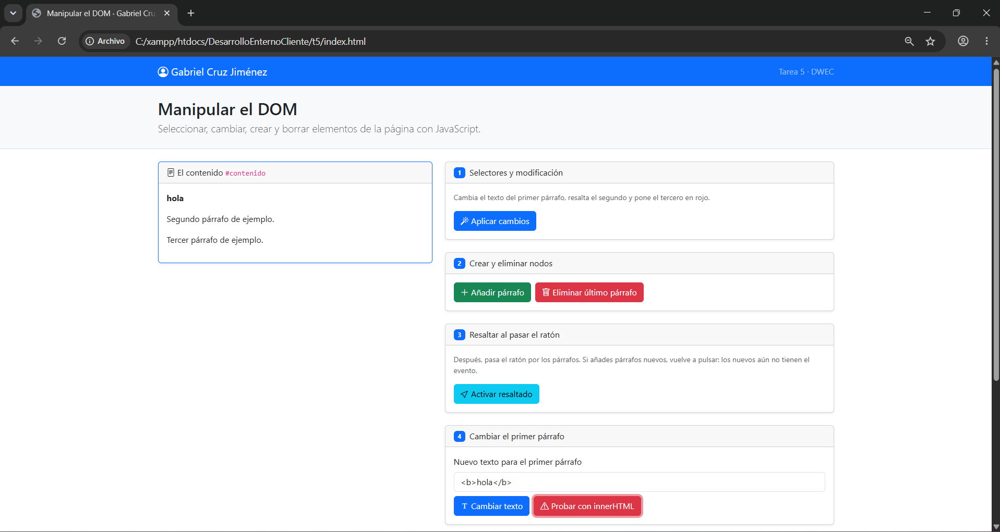
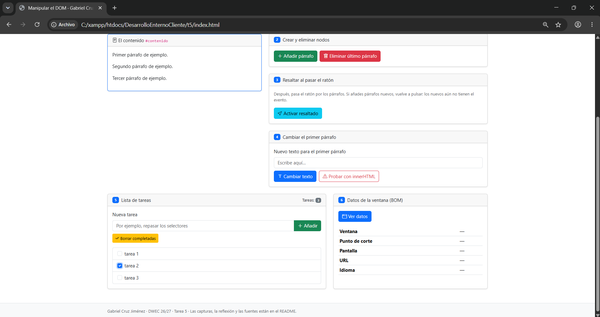
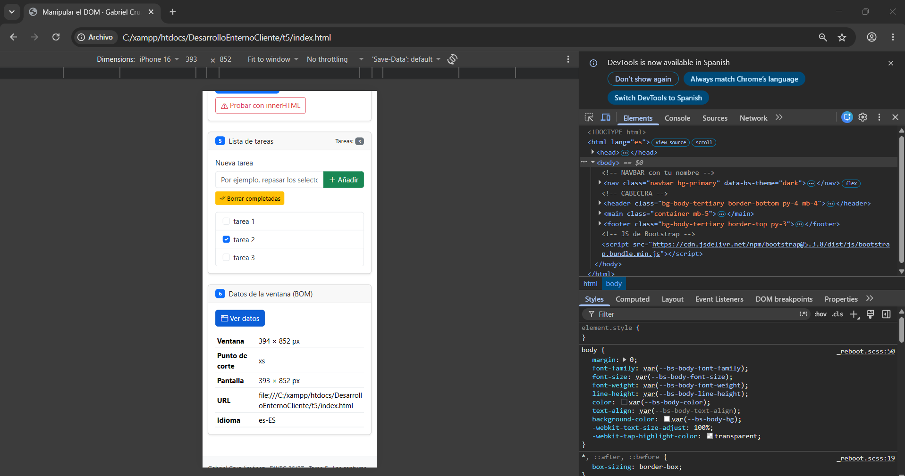

# Tarea 5 · Manipular el DOM

**Autor:** Gabriel Cruz Jiménez · DWEC · 2.º DAW

Práctica en desarrollo a partir de la plantilla de la asignatura.

Abrir http://localhost/DesarrolloEnternoCliente/t5/ con Apache iniciado en XAMPP.

## Capturas

**1. Página recién cargada**

Se ve la página al abrirla, con mi nombre en la navbar y los tres párrafos originales en el cuadro #contenido.

**2. Ejercicios 1 y 2 aplicados**

Tras pulsar «Aplicar cambios» el primer párrafo tiene el texto nuevo, el segundo está resaltado y el tercero en rojo. Después de «Añadir párrafo» aparecen los párrafos numerados al final.

**3. Párrafo resaltado con el ratón**

Con el resaltado activado, el párrafo bajo el puntero se ve en gris gracias a la clase `bg-body-secondary`.

**4. `<b>hola</b>` con innerHTML**

El navegador ha interpretado la etiqueta y muestra «hola» en negrita en el primer párrafo.

**5. Lista con tres tareas y una marcada**

La lista tiene tres tareas, la segunda con la casilla marcada, y el contador muestra 3.

**6. Datos de la ventana en modo móvil**

Con el modo dispositivo de F12 (iPhone 16), la tabla muestra una ventana de 394 × 852 px, punto de corte `xs`, pantalla de 393 × 852 px, la URL y el idioma `es-ES`.

## Párrafos nuevos en el ejercicio 3

`activarResaltado()` recorre los párrafos que existen en el momento de pulsar el botón y a cada uno le añade sus eventos con `addEventListener`. Un párrafo creado después no estaba en esa lista, así que no tiene los eventos y hay que volver a pulsar el botón para que los reciba.

## Reflexión

`textContent` pone lo que recibe como texto literal, mientras que `innerHTML` lo interpreta como HTML. Con `<b>hola</b>` lo vi claro: `textContent` mostró la etiqueta tal cual, y `innerHTML` mostró «hola» en negrita. Por eso nunca se mete en `innerHTML` lo que escribe el usuario: podría escribir código HTML con un script o un evento (por ejemplo, un ``) y se ejecutaría en la página, lo que se conoce como ataque XSS. Por esa razón las tareas de la lista se insertan con `textContent`.

## Fuentes

- [Plantilla de la asignatura](https://github.com/DRodero/DWEC_2627/tree/main/tema05_plantilla)
- [MDN: Node.textContent](https://developer.mozilla.org/es/docs/Web/API/Node/textContent)
- [MDN: Element.innerHTML](https://developer.mozilla.org/es/docs/Web/API/Element/innerHTML)
- [MDN: addEventListener](https://developer.mozilla.org/es/docs/Web/API/EventTarget/addEventListener)

## Uso de IA

Este README ha sido redactado con ayuda de Claude (Anthropic) a partir de mi código y del enunciado. [Indicar qué hice después con su respuesta: revisar, corregir, reescribir la reflexión con mis palabras…]