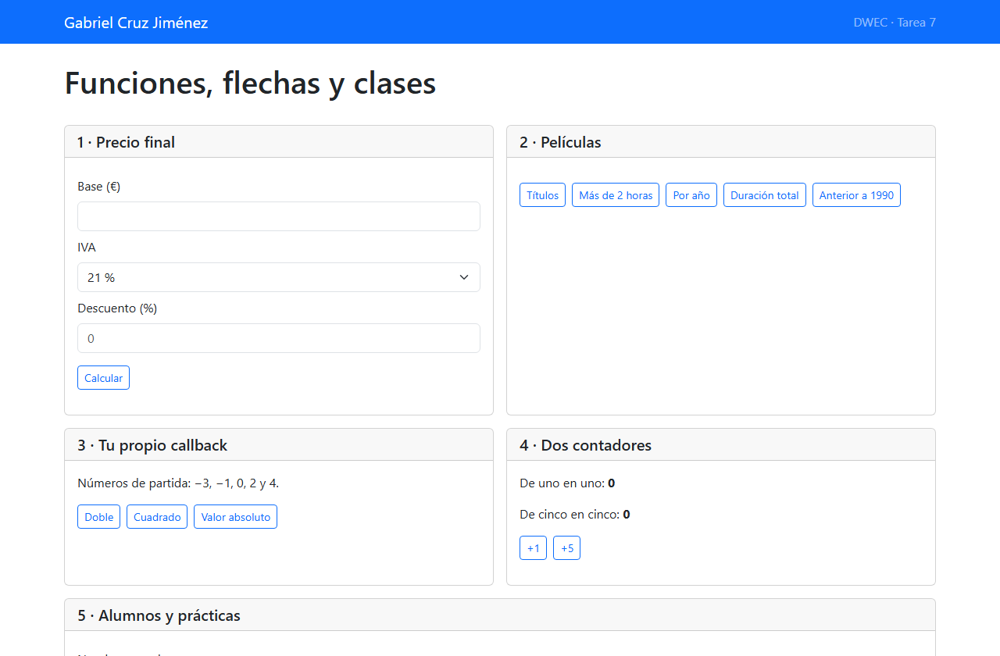
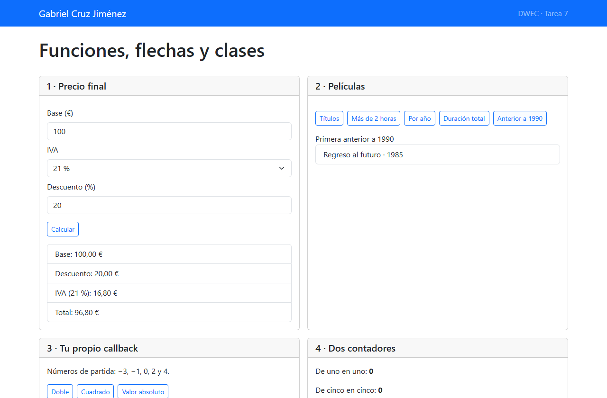
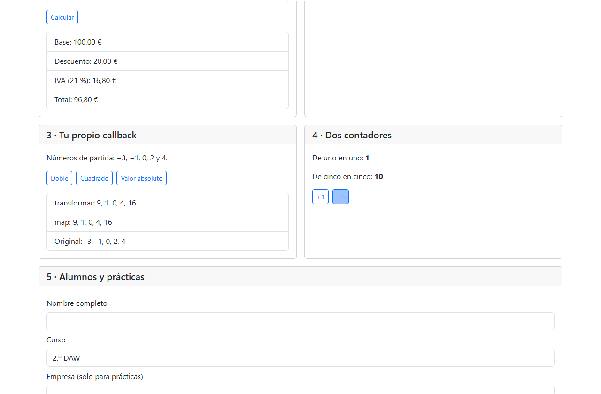
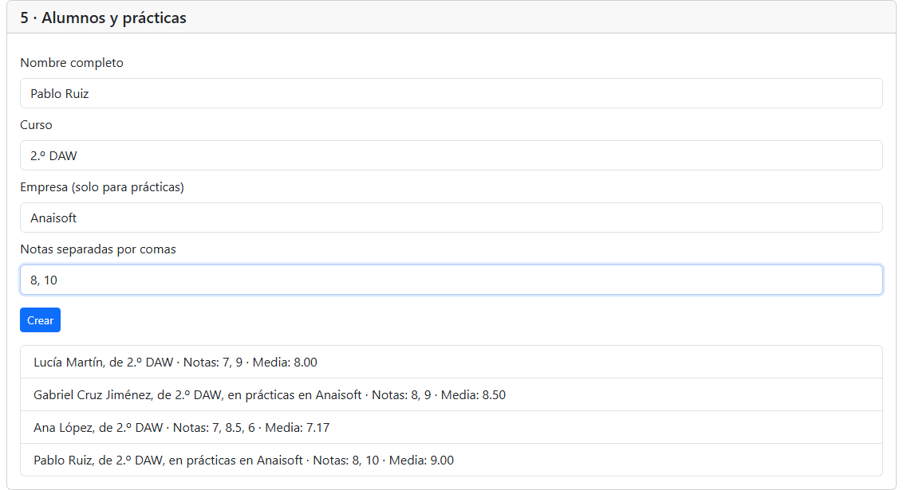
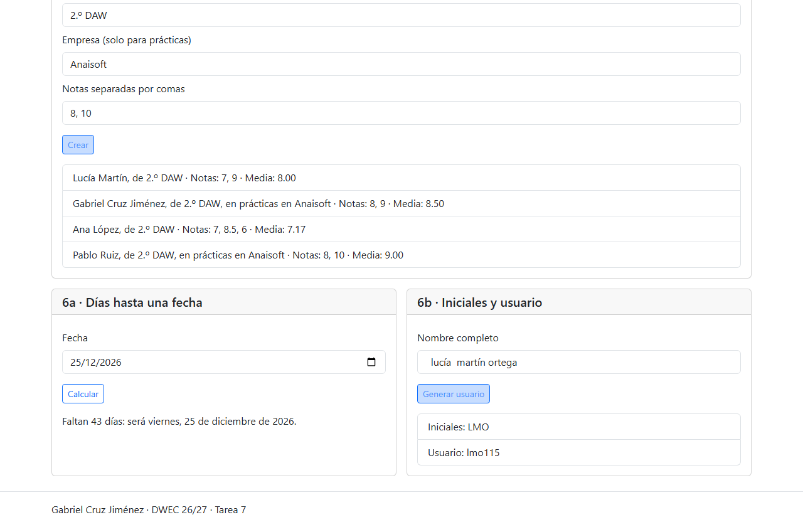

# Funciones, flechas y clases

**Gabriel Cruz Jiménez · DWEC · Tarea 7**

## Evidencias

La barra superior identifica al alumno. Al abrir la página se crean dos contadores independientes y dos alumnos con sus notas iniciales.

Sobre una base de 100 € se descuentan 20 €. El IVA del 21 % se calcula sobre los 80 € restantes, así que el total es 96,80 €. El botón de películas encuentra Regreso al futuro.

Al elevar al cuadrado los números, transformar y map producen la misma lista. Cada llamada a crearContador crea su propia variable cuenta. Por eso un contador marca 1 y el otro 10. Escribir cuenta en la consola da ReferenceError porque esa variable solo existe dentro de la función.

El formulario añade dos alumnos a los dos iniciales. Pablo aparece en prácticas, y sus notas de 8 y 10 dan una media de 9.

La fecha se muestra en español. Los espacios repetidos entre los nombres se descartan y el usuario empieza por lmo, seguido de tres cifras.

## Reflexión para revisar

En verTitulos, la flecha `p => p.titulo` devuelve el título de cada película.  
Con function, el mismo callback llevaría llaves y un return explícito.  
Si pongo llaves en esa flecha y olvido el return, map guarda undefined.  
En pintarLista, el callback de forEach añade elementos y puede terminar sin devolver un valor.  
En cambio, media() necesita leer this.notas del alumno que invoca el método.  
Una flecha toma this del ámbito donde se define, por eso la clase usa la sintaxis de método.

## Fuentes

- Apuntes de DWEC, *Tema 7. Funciones y objetos*, y enunciado *Tarea 7. Funciones, flechas y clases* facilitados en el campus.
- [Repositorio de la asignatura citado en el enunciado](https://github.com/DRodero/DWEC_2627). Esta versión reconstruye la interfaz a partir del PDF.

## Uso de IA

ChatGPT preparó el Readme.MD