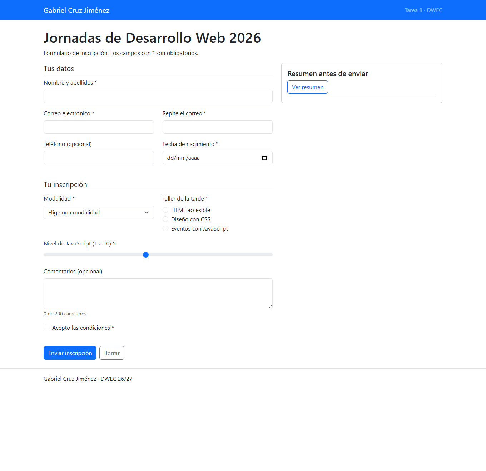
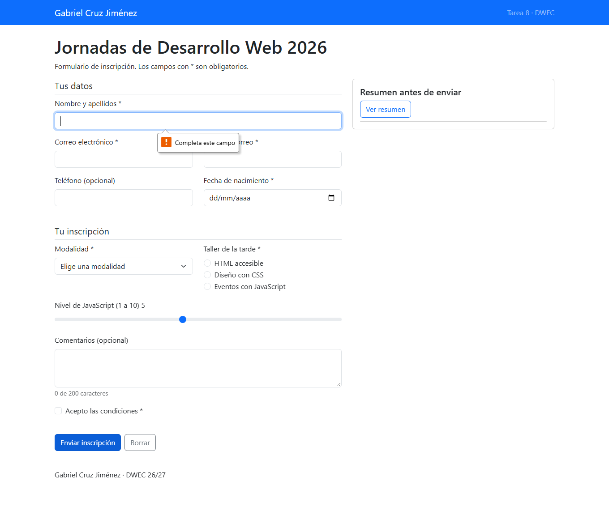
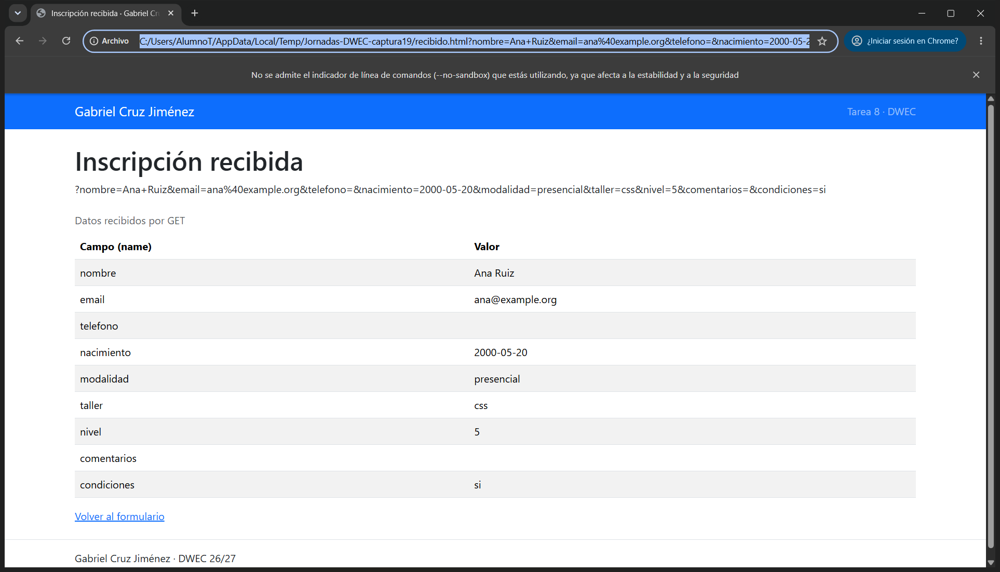
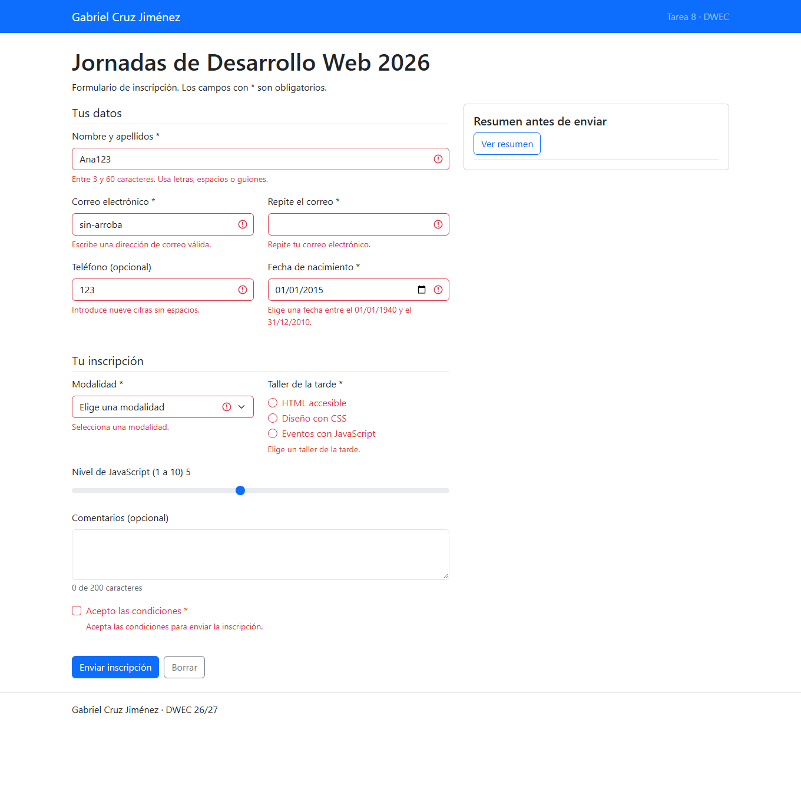
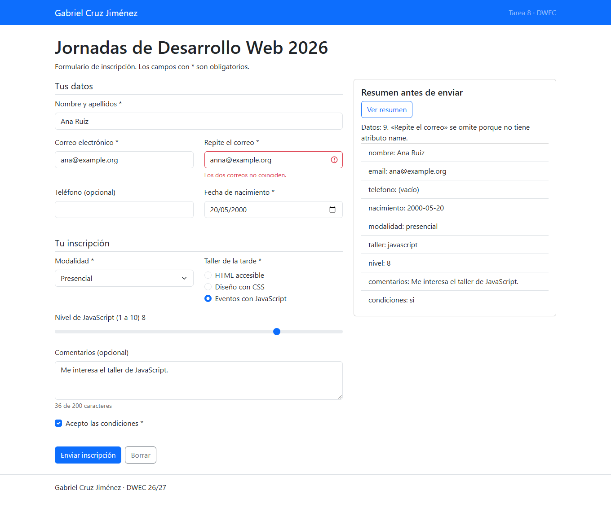

# Tarea 8 · Formulario de inscripción

**Gabriel Cruz Jiménez · Desarrollo Web en Entorno Cliente · 2.º DAW**

Abre `index.html` para inscribirte en las Jornadas de Desarrollo Web 2026. Con «Ver resumen» puedes revisar los datos antes de enviarlos. «Enviar inscripción» abre `recibido.html`, donde se ve qué campos han viajado por GET.

## Capturas

### a) Formulario recién abierto

«Tus datos» reúne los campos personales y «Tu inscripción» recoge las opciones de las jornadas. Al abrir la página, el nivel está en 5 y el contador marca 0 de 200.

### b) Validación del navegador

Antes de añadir `novalidate`, Chrome enfocó el nombre vacío y mostró «Completa este campo». Al quitarle `required` y rellenar el resto, el formulario se envió con `nombre=` en la URL.

### c) Datos recibidos por GET

Después de `?` aparecen los nombres y valores de los campos. «Repite el correo» se queda fuera porque carece de `name`. Una contraseña enviada así quedaría visible en la dirección y podría guardarse en el historial.

### d) Errores junto a los campos

`Ana123` incumple el patrón del nombre, `sin-arroba` falla como correo, `123` es demasiado corto para el patrón del teléfono y la fecha de 2015 supera el máximo permitido.

### e) Eventos y resumen

El nivel marca 8 y el comentario ocupa 36 de 200 caracteres. El aviso señala que los correos son distintos y el resumen muestra los nueve campos recogidos con `FormData`.

## Reflexión

Con JavaScript puedo mostrar varios errores al enviar el formulario.  
El foco en el primer campo incorrecto indica por dónde empezar.  
Al corregir cualquiera de los dos correos se vuelve a comprobar la coincidencia.  
La prueba con `required` demuestra que quien usa la página puede cambiar sus reglas.  
Por eso el servidor debe validar los datos antes de aceptarlos.  
La función flecha conserva el `this` del ámbito exterior. En este script es `window`, así que el manejador usa `e.target` para acceder al formulario.

## Fuentes

- [Plantilla del tema 8 y guion de la práctica](https://github.com/DRodero/DWEC_2627/tree/main/tema08_plantilla)
- Enunciado de clase, *Tarea 8. Formulario de inscripción*.

## Uso de IA

Se utilizó ChatGPT para redactar este borrador.
